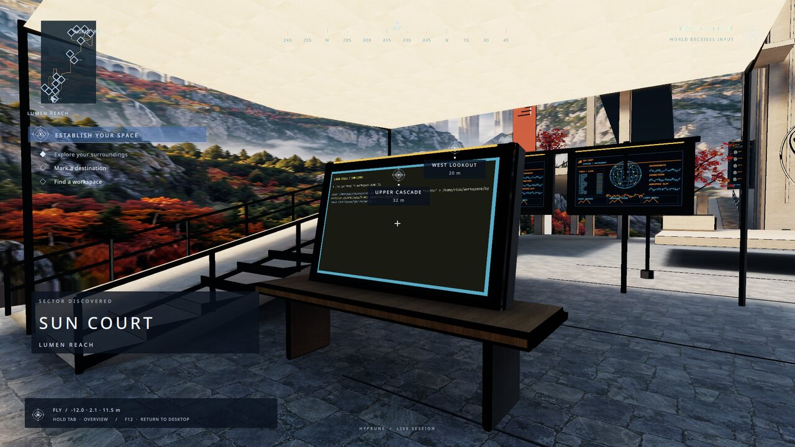

# Hyprune

**Your desktop is a place.** Walk between workspace homes, keep a terminal on a
desk, pull a window into reach, and warp to the next part of your day.

This is Hyprune's front door: compatible core, Quickshell shell, SDK, original
worlds and starter kits. Start in our vision, then change every part of it.
[hyprune.com](https://hyprune.com) · [Roadmap](https://hyprune.com/roadmap/) ·
[Keymap](https://hyprune.com/keymap/)



Early preview, targeting **Hyprland 0.56.2**. Core, shell and SDK speak IPC
**0.25**; the shell negotiates its newest supported protocol with core. Every
component is public on [GitHub](https://github.com/hyprune) under MIT (worlds:
CC-BY-4.0 content). Minimal is self-contained. **Lumen Reach 0.11.0**
(world format 0.9) and **Switchyard 0.1.2** are published releases, pinned by URL
and hash in [worlds/releases.json](worlds/releases.json) and fetched by the kits
that use them. The official object library, the **Hyprune starter kit**
(`com.hyprune.starter` 0.1.0), is pinned in
[libraries/releases.json](libraries/releases.json) and preinstalled by every
install path below. Dedicated DRM/hardware-cursor acceptance still needs a supervised
hardware checklist; container tests cannot verify it.

| Kit | First experience | Graphics | Distribution |
| --- | --- | --- | --- |
| `lumen-reach` | Sun Court, Array Hall, Rime Vault, Signal Rise; desk terminals and btop kiosk | High; switch to `intel` for a lighter tier | Lumen Reach 0.11.0 release |
| `minimal` | One quiet home, terminal, workspace wall and spare lectern; 12 triangles, no textures | Intel tier, bloom off, reduced motion | Included, original CC0 |
| `dev` | Switchyard plus a typed debug home; SDK doctor/mock and U debug capture | Auto | Switchyard 0.1.2 release |

All kits use core's M3B keymap and the shell's built-in dark theme. The loaded
world defines where workspaces are: the world itself runs on room workspace 20,
and each area's home is 20 plus its slot (Lumen Reach: 21 Sun Court, 22 Array
Hall, 23 Rime Vault, 24 Signal Rise; Minimal's Quiet Desk: 21). Kits launch their
apps on those homes and bind Super+1…9 to 21…29. Switchyard has legacy station
docks and no areas, so dev maps it as an explicit destination on workspace 30
(Super+0) without inventing typed home/mount contracts. GPU suitability depends
on hardware and output resolution; Minimal has no measured iGPU frame-rate
guarantee yet.

## Try it in 5 minutes

No install, no log out, no config edits and no sudo: everything goes into one
folder, and Hyprune opens in a window inside the desktop you are using.

```sh
curl -fsSL https://hyprune.com/check | bash   # read-only compatibility report
curl -fsSL https://hyprune.com/try | bash     # download into ~/hyprune-try and open it
```

`check` reports the session, Hyprland against the plugin ABI, GPU/GLES,
Quickshell, Python, Nix, disk and memory, with a verdict and the exact fix
command for your distribution. `try` runs the same checks and stops (printing
the commands) if anything is missing; it never runs a package manager. Then it
downloads core for the pinned Hyprland ABI (or builds it inside the folder until
a prebuilt release matches), the shell with a private venv, Lumen Reach and the
pinned object libraries, verifying every SHA-256, plus the `hyprune` CLI (the
Director's Library page uses it) when Node.js 22.12+ and npm are present, and opens a nested Hyprland window at Sun Court. Inside
the window Super chords also work with Alt; quit with Alt+Shift+Q.

```sh
curl -fsSL https://hyprune.com/try | bash -s -- --dir ~/hyprune-try --dry-run   # also --live, --world, --no-run, --no-libraries, --ref
~/hyprune-try/run          # the window again; --live loads into your running Hyprland, --stop undoes it
~/hyprune-try/uninstall    # deletes the folder; nothing else to undo
```

The prebuilt core matches Arch Linux's Hyprland 0.56.2. Elsewhere, or with
another Hyprland build, `nix run github:hyprune/hyprune#try` brings the pinned
compositor. Sources: [try/](try/); pinned, hash-checked copies and the full
walkthrough: [hyprune.com/try-it](https://hyprune.com/try-it/).

## Install

Everything installs from public repositories and release archives; no GitHub token
is needed. To build against local checkouts instead, see the
[Docker and Nix overrides](docs/contributing.md).

**Nix profile / other Linux distributions:**

```sh
nix profile install github:hyprune/hyprune#kit-minimal
hyprune-setup install
# Log out. From a TTY:
hyprune-session
```

`default` is the Minimal bundle; `kit-lumen-reach` and `kit-dev` also fetch the
corresponding release worlds. Outside the Nix profile, configure those kits with
`hyprune-setup install --kit /path/to/kits/<kit>/kit.toml --world-dir /path/to/world-package/share/hyprune/worlds`.
For a new kit, first move the existing starter config and layout aside as described
in [kit authoring](docs/kits.md). Nix modules supply these paths automatically.

**NixOS:** add `inputs.hyprune.url = "github:hyprune/hyprune"` to your flake, then:

```nix
imports = [ inputs.hyprune.nixosModules.default ];
programs.hyprune = {
  enable = true;
  kit = "minimal"; # or "lumen-reach", "dev"
  worlds = [];    # additional "lumen-reach", "switchyard", "minimal"
  settings.graphics = { quality = "intel"; reduced_motion = true; };
  libraries.pinned = true; # official object libraries, read-only (the default)
  libraries.extra = [];    # more library roots holding <id>@<version>/ directories
};
```

The pinned libraries are fixed-output downloads unpacked with the installer's
archive rules; the session's `HYPRUNE_LIBRARY_DIR` lists them, so the Director
shows them as system-managed (update or remove them in your configuration).

Rebuild and choose **Hyprune (minimal)** at login, or run `Hyprland` from a TTY.
The module selects the same pinned compositor used to compile the plugin, plus
its matching portal. Use Hyprune as the session entry point; UWSM credential
handoff is not implemented.

**Home Manager:** use `inputs.hyprune.homeManagerModules.default` with the same
`programs.hyprune` options. It sets `configType = "lua"`, the plugin path in
`wayland.windowManager.hyprland.plugins`, and a user-owned Lua include. Launch
Home Manager's `Hyprland` wrapper from a TTY. On NixOS, enable the system's
`programs.hyprland` with `inputs.hyprune.packages.${pkgs.stdenv.hostPlatform.system}.hyprland`
and its matching portal for system integration; let Home Manager own this user's
kit. Use one Hyprune module per user/session, rather than applying both starters.

**Arch script:** with Hyprland 0.56.2 installed:

```sh
git clone https://github.com/hyprune/hyprune
cd hyprune
./install.sh --kit minimal --dry-run
./install.sh --kit minimal
# Add ~/.local/bin to PATH. Log out, then start from a TTY:
hyprune-session
```

The script checks both the compositor binary and plugin-header version, builds
the pinned core and SDK (the `hyprune` CLI), unpacks the pinned object libraries
into `~/.local/share/hyprune/libraries/<id>@<version>/` (`--no-libraries` skips
them), records them and the kit's release worlds as official installs in
`~/.local/state/hyprune/content.json` so `hyprune` can update them, installs the Python bridge in a private venv, and uses
Arch's Quickshell. It uses CMake because core has no hyprpm manifest; see the
[proposal and helper-path prerequisite](proposals/README.md). It doesn't change
the compositor version for you. A newer Arch Hyprland must be deliberately
replaced with a matching build, or use Nix's pinned compositor.

Your normal Hyprland config is separate. To use it, pass
`--hyprland-config ~/.config/hypr/hyprland.lua`: the script displays the exact
diff, asks, and writes a timestamped backup before adding an include. There is
no unattended approval flag and no live reload/plugin-load command. Then launch
`hyprune-session --config ~/.config/hypr/hyprland.lua` from a TTY.

The script also puts the Hyprune app icon in `~/.local/share/icons/hicolor` and
writes a login-screen entry to `~/.local/share/hyprune/install/share/wayland-sessions/`;
it prints the `sudo install` line that lists Hyprune on your login screen, and
never runs it for you.

`./install.sh --uninstall --dry-run` previews removal; `--uninstall` removes
unchanged wrappers and icons, the libraries it unpacked (unless you updated them
since), and moves the installed build to a rollback backup. Removing
the include also requires its own diff/confirmation. Config, state, worlds,
backups and distro dependencies remain yours. Rerunning install preserves edits
and existing worlds. **Fedora/Debian package installation is not implemented or
validated**; the script reports that honestly and stops. Nix is the available
packaging path there.

## Zero to the trailer

Choose `lumen-reach`. With a release archive you already downloaded, the
[local archive path](docs/zero-to-the-trailer.md) works offline.

1. Install the kit and start its Hyprune session. Press **Super+F12** to enter
   the world. **F12** always returns to the desktop.
2. Walk toward Sun Court's workspace wall with **WASD**, **HJKL**, or arrows;
   move the mouse to look. Space jumps, Shift runs.
3. Hold **TAB for one second**, then release: Director Map stays open. Escape
   closes it. Settings edits the independently watched keymap.
4. Press **Super+1** for Sun Court's home (workspace 21), then **Super+Enter**
   for an extra terminal there. Aim at it on the wall, hold **Super+left
   mouse** to pull/carry it, and move it onto the spare desk. Slot **2**, tag
   the window, then click the desk to mount it. **E** uses it in place;
   **Super+TAB** returns to walking.
5. Hold TAB, open **Workspaces**, and select **Array Hall**. Core takes you
   to that home (workspace 22). **Super+2** also selects it. Warp out to
   another installed world through its mapped workspace; add `dev`'s
   Switchyard destination (workspace 30) to a forked kit for a cross-world
   trip. **F** brings an aimed app or workspace into native 2D; Super+TAB
   brings you back.

The full illustrated walk-through is
[docs/zero-to-the-trailer.md](docs/zero-to-the-trailer.md), ready to wire into
the documentation site. Still-image labels reflect the capture's earlier input
revision; the instructions here use the current M3B keymap.

## Make it yours

Kits are TOML data, compiled into the existing Lua, input JSON, workspace-location
JSON and persistent layout contracts. Files under `~/.config/hyprune` and
`~/.local/state/hyprune` are written only when absent. Changing the module's kit
or settings supplies new defaults for a fresh profile; it does not overwrite an
existing profile. [Fork a kit or start from scratch](docs/kits.md).

### Feed a gauge from a script

Placed gauges (and other machines) show data that core's source helper publishes.
Every install ships it with core: `libexec/hyprune/source-helper`, the gauge
script `share/hyprune/machines/system-gauges.py` (CPU, RAM, GPU, VRAM) and the
command `hyprune-system-gauges` that runs it, under core's prefix (the Nix `core`
package, `~/.local/share/hyprune/install/current` for the Arch script, `core/` in a
try folder). A newly placed machine starts with a demo source (`hyprune-demo-source`,
made-up values for its inputs) that the shell writes into `sources.json`; replace it
with your own command as below, or remove it.

1. Place a gauge: Director → Objects → Catalog, add a gauge (Machines), place it
   with tool 5.
2. Note its instance id: Director → Objects → Placed shows `Data source id: u-3f9a1c`.
3. Write `~/.config/hyprune/sources.json` (`$XDG_CONFIG_HOME/hyprune`), one entry
   per gauge, with the instance id as `id`:

   ```json
   {"sources": [
     {"id": "u-3f9a1c", "kind": "command", "argv": ["hyprune-system-gauges", "ram"],
      "intervalS": 5, "timeoutS": 4}
   ]}
   ```

   Any executable that prints one JSON object such as
   `{"value": 71, "display": "71%", "label": "RAM", "level": "ok"}` works; give its
   absolute path. Use `intervalS` 10 or more for `gpu` and `vram`.
4. Start `hyprune-session` (or your Nix session). It always starts the helper right
   after the shell, with its own `data.publish` grant for `com.hyprune.sources` and
   `--config` pointing at `sources.json` (it idles while the file does not exist), and
   stops it with the session. Its log is `~/.local/state/hyprune/source-helper.log`.

Edits to `sources.json`, including a new file, apply while the session runs. The
helper renews its grant through core whenever it reconnects: the session starts core's
`hypruned` through `runtime/session-daemon`, which hands it a private grant channel
(`HYPRUNE_GRANT_FD`) that only `hypruned` and the session hold. The session does not
restart a helper that exits (as with the shell); the next session starts a new one.
The source format, script contract and limits are in core's
[machines guide](https://github.com/hyprune/core/blob/main/dev/machines/README.md).

Code and docs: MIT. Quiet Desk: CC0-1.0. Lumen Reach gallery stills: Hyprune
contributors, CC-BY-4.0, resized without retouching;
[image provenance](docs/images/provenance.json). Logo and app icons: Hyprune
contributors, CC-BY-4.0; usage rules and exports in [brand/](brand/README.md). No prototype/game assets are used.

[Contributor builds and Docker testing](docs/contributing.md) ·
[Verification report](docs/verification.md) · [Release checklist](docs/releases.md)
