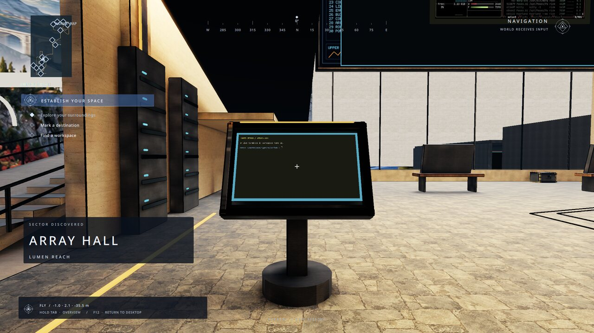
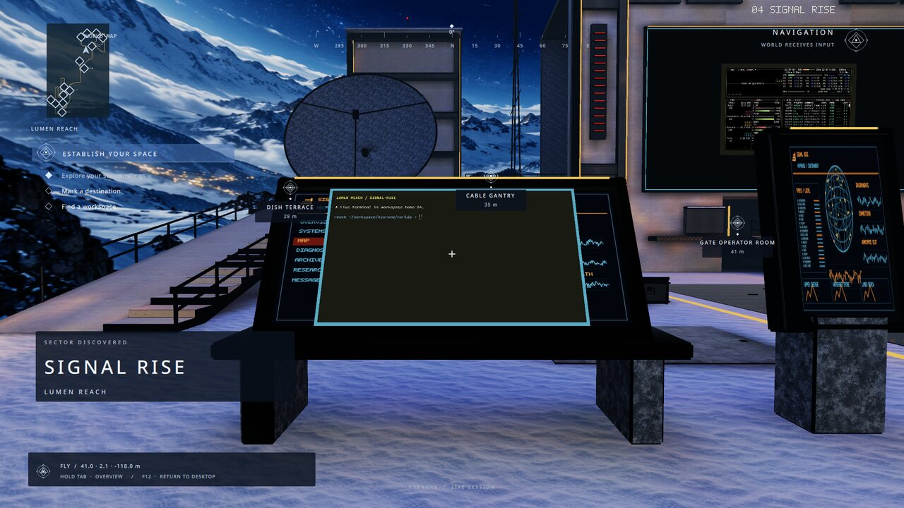

Hyprune starts with a place you can enjoy immediately, then gives you the controls
to rearrange it. **Lumen Reach** is the showcase: four connected workspace homes
with original architecture, baked lighting, and live applications on tool mounts.


This guide uses Hyprland **0.56.2**, IPC **0.22** (core and shell), and the
`lumen-reach` kit with the published **Lumen Reach 0.10.2** release (pinned by URL and
hash in `worlds/releases.json`). These are early preview builds, built from the public
[hyprune repositories](https://github.com/hyprune). The
[Minimal kit](https://github.com/hyprune/hyprune#install) can be installed without a world download;
its room has a workspace wall and two tool mounts, with the same controls.

## Install your place

On NixOS or Home Manager, import the matching Hyprune module and set:

```nix
programs.hyprune = {
  enable = true;
  kit = "lumen-reach";
  settings.graphics.quality = "high"; # "intel" is the lighter tier
};
```

Rebuild and select the Hyprune login session (NixOS), or start the Home Manager
`Hyprland` wrapper from a TTY. The kit fetches the pinned release; a hash mismatch
fails instead of substituting a different world.

On Arch:

```sh
./install.sh --kit lumen-reach --dry-run
./install.sh --kit lumen-reach
```

Offline, an archive you already downloaded can be supplied with its independently
verified checksum. This doesn't relax hash checking:

```sh
sha256sum /path/to/com.hyprune.lumen-reach-0.10.2.tar.zst
./install.sh --kit lumen-reach --source-root /path/to/hyprune \
  --world-package lumen-reach=/path/to/com.hyprune.lumen-reach-0.10.2.tar.zst \
  --world-sha256 lumen-reach=REPLACE_WITH_VERIFIED_64_HEX_SHA256
```

The script prepares a standalone starter config. It extends your regular Lua
config only if you request `--hyprland-config`, review the diff and answer yes;
that creates a timestamped backup. It never loads the plugin into a running
session. Fedora/Debian script installation is not supported yet.

## First launch

Log out first. Start the Hyprune session from your login screen or run
`hyprune-session` from a TTY. The launcher starts its own compositor, supplies
one-use credentials through memory-only pipes, waits for that child's plugin,
then starts the shell and kit apps. No separate `hypruned` service is needed:
the plugin starts its matching helper.

The launcher also loads the kit's first world through a separate, one-use
`world.control` grant. This avoids core's developer-atrium fallback on the first
toggle. It grants no compositor IPC access to a kit or world package.

Press **Super+F12**. You arrive in **Sun Court**, facing its first home. The
world defines the workspaces: the world itself runs on room workspace 20, and
Sun Court's home is workspace 21 (its area slot 01 plus 20). A desk terminal and
a btop kiosk are already placed; you can remove them from your kit's app list.
**F12** exits world mode even if the shell has failed.

If the shell needs restarting after connection loss, restart this Hyprune session.
Core currently has no production token-renewal API; a systemd `Restart=always`
service would reuse a spent token and cannot fix that.

## Walk to your first workspace home

Move with **WASD**, **HJKL**, or arrows and look with the mouse. Space jumps,
Shift runs, Ctrl crouches. Follow the Sun Court terrace toward its large wall:
that wall shows your actual workspace, and desk displays show live tools.
Some instrument panels are authored artwork, labeled in the world; they are not
host-data integrations.

Aim at a workspace wall and press **E** to use it in place, or **F** to move into
the usual native 2D workspace. **Super+TAB** or the Back mouse button returns you
to the world. Shortcuts are intercepted only in the active mode that owns them.

## Hold TAB

Hold **TAB continuously for 1000 ms**, then release it. The Director opens Map
and stays open. Core owns that timing; Settings can change it and remap keys in
`~/.config/hyprune/input.json` without reloading Hyprland. Escape closes Director.

Map lets you mark a destination or start collision-checked auto-drive along an
authored route. Workspaces lists your mapped homes and apps. Keep F12 in mind as
the direct way back to the desktop.

## Pull a terminal onto a desk

Press **Super+1** for Sun Court's home, workspace 21. There, **Super+Enter**
opens an additional terminal on the workspace wall. Aim at its rectangle, hold
**Super+left mouse**, and pull it out into 3D. Walk it toward the spare operator
desk; use the wheel to change carry distance. Release to leave it in space.

For deliberate mounting, press **2** for the window tool, click the window to
tag it, then click the desk surface in place mode. The tool's HUD shows the
current submode; the wheel selects place/lock. Select a free desk in the window's
own home. Core refuses occupied mounts and checks placement against geometry.
**1** returns to the normal tool. **E** lets you type in place; Super+TAB backs
out. Core remembers the placement by application class/title after relaunch.

You can also drag with Super+left mouse, resize with Super+right mouse, and roll
with Super+middle mouse. Dropping onto a workspace wall returns the window to
native tiling. Return/Recall in Director can recover tools you lose track of.

## Travel, then warp



Hold TAB and choose **Workspaces → Array Hall**. Core selects workspace 22 and
takes you to its authored home. Super+2 has the same workspace destination;
Super+3 selects Rime Vault (23) and Super+4 selects Signal Rise (24). Map's
point travel offers the warp presentation between locations; auto-drive follows
the route.



The showcase kit keeps its four homes inside one connected world. For a
cross-world warp, fork the kit and add an explicit home on workspace 30 mapped
to `com.hyprune.switchyard`, spawn `arrival`, and add `switchyard` to `worlds`.
Select that destination in Workspaces: core loads the installed world and shows
the warp lifecycle. Switchyard's legacy station docks aren't typed workspace
homes yet; use them as the dev kit does, with Minimal's Quiet Desk (21) as the
separate debug home for mounts.

## Keep changing it

Your starter files are yours after the first generation. Edit the Lua include for
graphics and movement, Settings for keys, and the kit for the next fresh profile.
Existing layout/editor state survives rebuilds. See [kit authoring](https://github.com/hyprune/hyprune/blob/main/docs/kits.md) to
fork the full showcase or start with an empty desk.

Images are original Hyprune Lumen Reach gallery stills, Hyprune contributors,
CC-BY-4.0; [source hashes and resize record](https://github.com/hyprune/hyprune/blob/main/docs/images/provenance.json). Their on-screen
control hints predate M3B; use the current controls in this guide.
